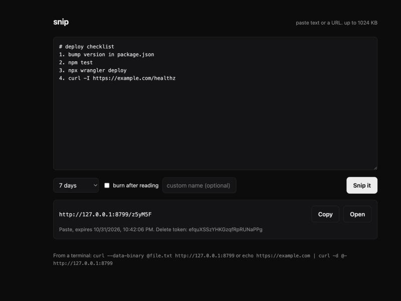
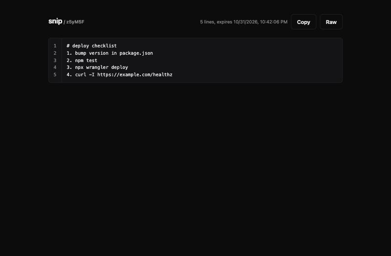

# snip

A paste bin and link shortener in one Cloudflare Worker. Paste text and get a link. Paste a URL and get a short link. It runs on the Cloudflare free tier and you can deploy your own copy in about two minutes.



- Works from a browser or straight from `curl`
- Pastes expire after 10 minutes, an hour, a day, 7 days, 30 days, or never
- Burn after reading: the paste is deleted the first time someone opens it. Link previews in Discord, Slack and other chat apps do not count as opening it
- Custom names for links, like `/docs` or `/resume`
- Every snip comes with a delete token
- Optional token so only you can create snips. Reading never needs one
- No database, no build step, no dependencies at runtime. One KV namespace

## Use it

From a terminal:

```console
$ curl --data-binary @notes.txt https://snip.example.com
https://snip.example.com/k7Qm2x

$ echo https://github.com/cipherhex09 | curl -d @- 'https://snip.example.com?slug=gh'
https://snip.example.com/gh

$ git diff | curl --data-binary @- 'https://snip.example.com?ttl=1h'
https://snip.example.com/Rt4wZp

$ echo "the wifi password is hunter2" | curl --data-binary @- 'https://snip.example.com?burn=1&ttl=1d'
https://snip.example.com/9bXcVn

$ curl https://snip.example.com/k7Qm2x
...the raw text of notes.txt...
```

A shell function makes it one word:

```sh
snip() { curl -s --data-binary @"${1:--}" "https://snip.example.com/?ttl=${TTL:-7d}"; }

snip notes.txt
pbpaste | snip
TTL=1h snip server.log
```

Opening a paste in a browser shows it with line numbers and a copy button:



## API

Everything happens at the root URL.

**Create**: `POST /` with the text or URL as the body. Raw text, `application/json` (`{"content": "...", "ttl": "1d"}`), or a form with a `content` field or a `file` upload all work.

| Option | Values | Default |
|---|---|---|
| `ttl` | `10m`, `1h`, `1d`, `7d`, `30d`, `never` | `7d` |
| `burn` | `1` to delete after the first read | off |
| `slug` | 2 to 64 letters, numbers, `_` or `-` | random 6 characters |
| `type` | `paste` or `link`. Use `type=paste` to store a URL as text | guessed |

Pass options as query parameters or as fields in the JSON or form body. A body that is a single `http` or `https` URL becomes a short link.

The response is the new URL as plain text, with the delete token in the `X-Delete-Token` header. Send `Accept: application/json` to get JSON instead:

```json
{
  "id": "k7Qm2x",
  "url": "https://snip.example.com/k7Qm2x",
  "raw": "https://snip.example.com/k7Qm2x/raw",
  "kind": "paste",
  "expires": 1793491200000,
  "burn": false,
  "deleteToken": "tW8...."
}
```

**Read**: `GET /<id>`. Browsers get the HTML view, everything else gets the raw text. `GET /<id>/raw` is always raw. Links redirect with a 302.

**Delete**: `DELETE /<id>` with `Authorization: Bearer <delete token>`.

```sh
curl -X DELETE -H "Authorization: Bearer tW8...." https://snip.example.com/k7Qm2x
```

## Deploy your own

You need a Cloudflare account (the free plan is fine) and Node.js 18 or newer.

```sh
git clone https://github.com/cipherhex09/snip
cd snip
npm install
npx wrangler login
npx wrangler kv namespace create SNIPS
```

Copy the `id` that the last command prints into `wrangler.toml`, replacing `REPLACE_WITH_YOUR_KV_ID`. Then:

```sh
npx wrangler deploy
```

Wrangler prints your `*.workers.dev` URL. To use your own domain, add a [custom domain](https://developers.cloudflare.com/workers/configuration/routing/custom-domains/) to the Worker in the Cloudflare dashboard.

### Lock it down

An open paste bin on the internet will eventually be found and abused. To make creating snips require a token:

```sh
npx wrangler secret put SNIP_TOKEN
```

Then send it with every create:

```sh
curl -H "Authorization: Bearer $SNIP_TOKEN" --data-binary @notes.txt https://snip.example.com
```

The web page shows a token field when one is required and remembers it in that browser.

### Settings

Set these under `[vars]` in `wrangler.toml`:

| Variable | What it does | Default |
|---|---|---|
| `MAX_BYTES` | Largest paste in bytes (KV allows up to 25 MiB) | `1048576` |
| `ID_LENGTH` | Length of random ids | `6` |
| `SNIP_TOKEN` | Secret needed to create snips. Set it with `wrangler secret put` | none |

### Free tier limits

Workers KV on the free plan allows 100,000 reads and 1,000 writes a day. Each new snip is one write, each view is one read, so a personal or small team instance stays well inside that.

## Develop

```sh
npm run dev    # local server at http://localhost:8787 with a local KV store
npm test       # runs the test suite against the real Workers runtime
```

## License

MIT
